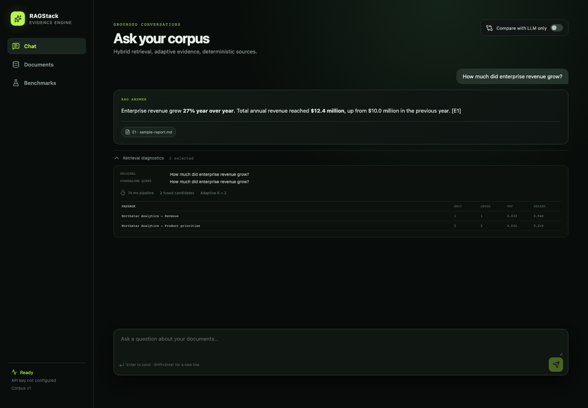
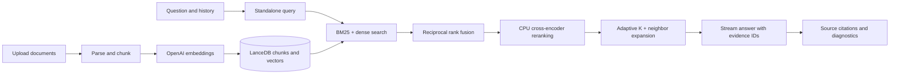
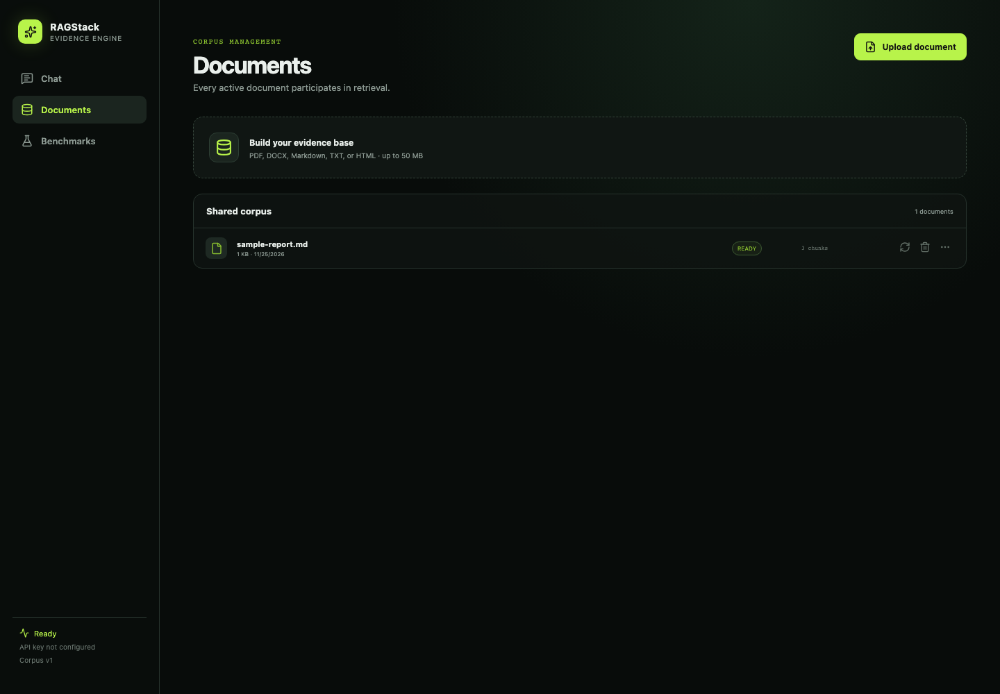
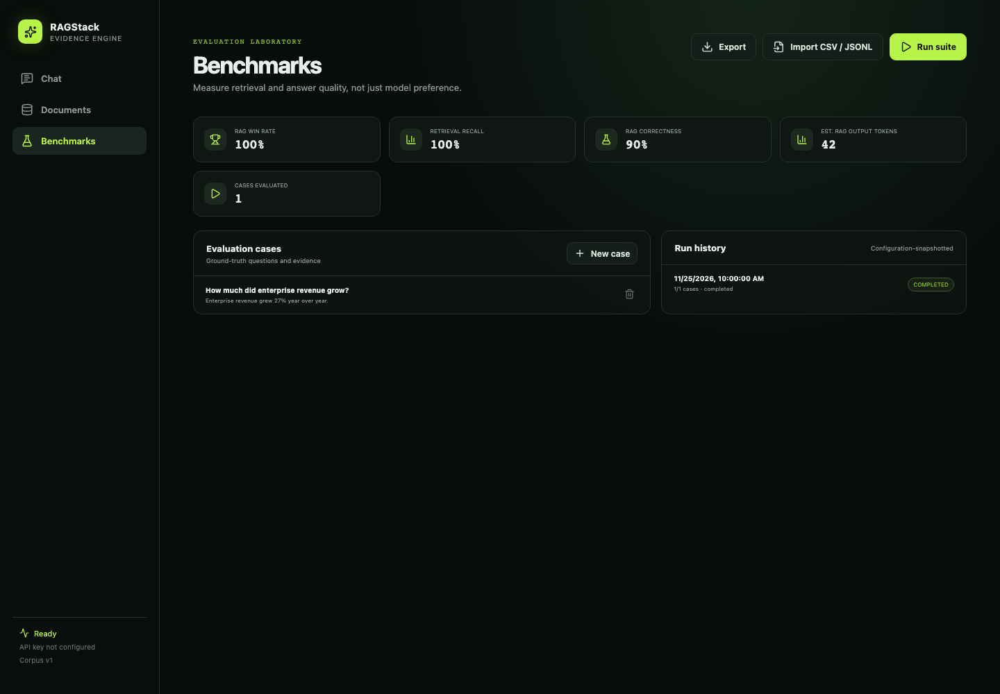

# RAGStack

Conversational document search with hybrid retrieval, inspectable evidence, and built-in evaluation.

RAGStack lets you upload documents, ask questions and follow-ups, and inspect the passages behind each answer. It is a single-user, locally run AI engineering project built with **FastAPI, React, TypeScript, LanceDB, SQLite, and OpenAI**.


*Actual application UI with fictional, deterministic fixtures. Answers, timings, and scores shown in screenshots are illustrative, not measured model results.*

## What you can explore

- **Document ingestion:** PDF, DOCX, Markdown, plain text, and HTML; structure-aware chunks, duplicate detection, and versioned reindexing.
- **Hybrid retrieval:** lexical BM25 and dense vector search, explicit reciprocal rank fusion (RRF), a CPU cross-encoder reranker, adaptive evidence selection, and neighboring passages.
- **Grounded conversations:** streamed answers, source excerpts and original-document links, follow-up query rewriting, and per-stage retrieval diagnostics.
- **Evaluation tooling:** optional LLM-only comparison, blinded pairwise judging, reference answers, retrieval metrics, case import/export, and live run progress.

## How it works



SQLite stores document versions, ingestion jobs, conversations, and evaluation runs. The server resolves citation filenames and pages from stored metadata. [Architecture and tradeoffs](docs/architecture.md) explains the data flow and code map.

## Run locally

**Prerequisites:** Python 3.10–3.13, Node.js 22, npm, and `make`. Setup downloads Python/JavaScript dependencies; caching the reranker also downloads model weights. Live ingestion and chat require an OpenAI API key with access to the models selected in your configuration.

```bash
git clone https://github.com/maximerbc/RAGStack.git
cd RAGStack
make setup
cp .env.example .env
```

Edit `.env`: set `OPENAI_API_KEY` and select generation, rewrite, judge, and embedding models available to your account. Keep credentials in the ignored `.env` file. Live ingestion, chat, and judging make billable API calls; document text and questions are sent to OpenAI as needed for these operations.

```bash
make model
make dev
```

Open [the application](http://127.0.0.1:5173) or [the API documentation](http://127.0.0.1:8000/docs). Stop both development servers with `Ctrl+C`. Start with the [sample document and walkthrough](docs/walkthrough.md).

You can run the automated checks without an API key. These use deterministic AI/reranker fakes; they do not demonstrate live model quality or offer an offline chat mode.

## Development commands

| Command | Purpose |
| --- | --- |
| `make setup` | Create `.venv`, install backend dependencies and locked frontend dependencies |
| `make dev` | Start FastAPI and Vite on loopback addresses |
| `make test` | Run backend and frontend unit/integration tests |
| `make lint` | Check Python and frontend code |
| `make build` | Type-check and build the frontend |
| `make browser` | Install Chromium for browser tests |
| `make e2e` | Run browser navigation checks |
| `make model` | Download/cache the CPU reranker |
| `make perf` | Run the synthetic 50,000-chunk warm-retrieval check |
| `make backend` | Start FastAPI; also serves the frontend after `make build` |

[Evaluation methodology](docs/evaluation.md) documents case formats, metric limitations, and the difference between synthetic checks and end-to-end performance. CI runs lint, tests, build, and browser checks with fake AI providers and no API credentials.

## Screens

| Documents | Benchmarks |
| --- | --- |
|  |  |

All screenshots use fictional fixtures. Recreate them with `cd frontend && npm run screenshots` after `make browser`.

## Project map

| Location | Responsibility |
| --- | --- |
| `backend/app/api/` | HTTP endpoints and server-sent events |
| `backend/app/services/` | Ingestion, retrieval, generation, and evaluation |
| `backend/app/config.py`, `db.py`, `schemas.py` | Configuration, SQLite persistence, and data contracts |
| `frontend/src/` | Chat, document management, benchmarks, and API client |
| `backend/tests/`, `frontend/tests/` | Backend checks and browser flows |
| `examples/` | Fictional document for the local walkthrough |
| `docs/` | Architecture, evaluation, walkthrough, and screenshots |

## Current boundaries

This is a local, single-user application. Authentication, multi-user isolation, and a hosted deployment are outside its current scope. Health status reports application readiness and configured credentials, not verified access to the provider. OCR is not a supported workflow; start with text documents or text-based PDFs. The parser delegates PDF/DOCX conversion to Docling, whose behavior may vary with its installed version.

Citation checks validate evidence IDs; they do not prove that every generated claim is supported. LLM judge scores are estimates, and the repository does not include a measured quality study or production latency results. Agents, GraphRAG, HyDE, multi-query expansion, and RAPTOR are outside v1.
