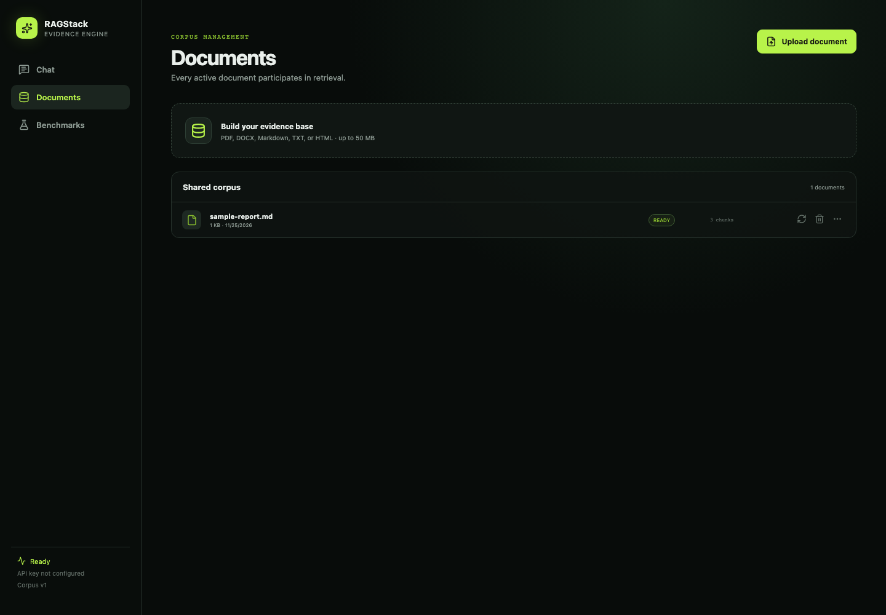
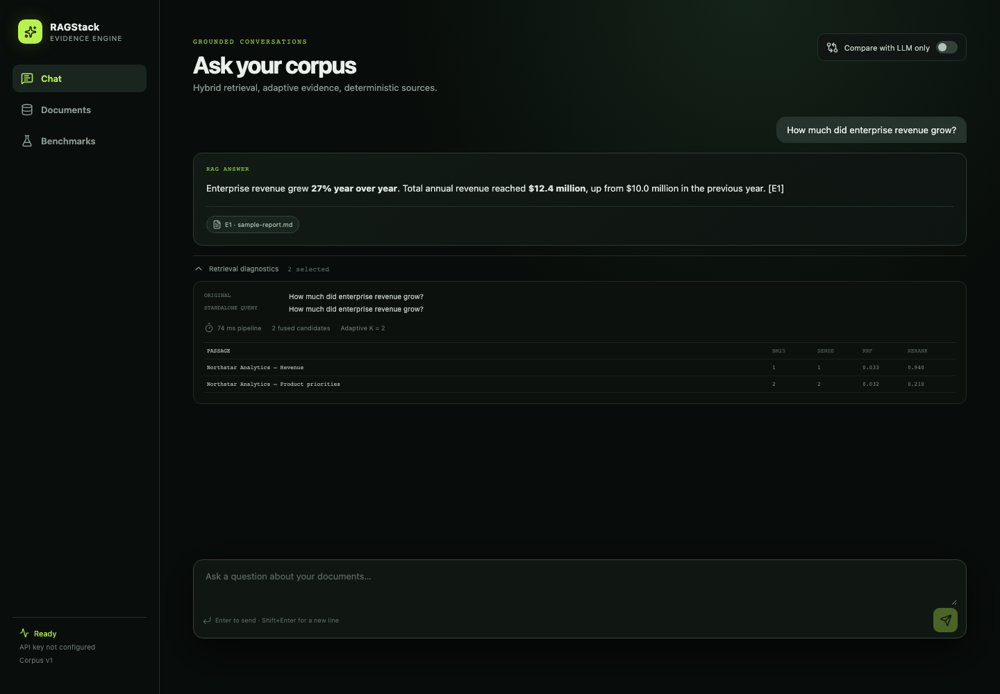
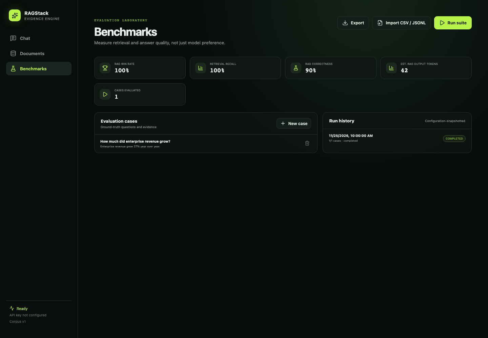

# Local walkthrough

[Back to the overview](../README.md)

The screenshots show the actual React application populated through intercepted API responses. The sample company, answers, retrieval timings, and benchmark scores are fictional fixtures. They illustrate the interface, not live model performance. There is no hosted or offline chat demo.

## 1. Start and upload

Follow the README setup steps, configure models available to your account, then run `make model` and `make dev`. Live operations use billable API calls. Open the Documents screen and upload [`examples/sample-report.md`](../examples/sample-report.md). Wait until its status is **ready**; indexing creates embeddings through OpenAI.



If ingestion fails, inspect the row's error and backend terminal. Check credentials/model access, network access, and embedding dimensions. Reindex after correcting configuration. An identical upload is rejected rather than indexed twice.

## 2. Ask and inspect

Open Chat and ask: **How much did enterprise revenue grow?** The sample document states **27% year over year**. Open a citation to inspect the excerpt and original file. Expand **Retrieval diagnostics** to see the standalone query, lexical/dense ranks, fusion score, reranking, and timings.



Try a follow-up such as **What are the product priorities?** Also ask **When is the next release?** The document says no date has been announced; use this to inspect how the live model handles insufficient information. Exact wording and retrieval results vary.

The optional comparison toggle generates an LLM-only answer and a reference-free judge result, adding API calls. It does not supply ground truth.

## 3. Define an evaluation case

Get the uploaded document ID from `GET /api/documents` at [the API documentation](http://127.0.0.1:8000/docs). In Benchmarks, choose **New case** and enter:

- Question: `How much did enterprise revenue grow?`
- Reference answer: `Enterprise revenue grew 27% year over year.`
- Relevant document ID: the ID returned by your local API.
- Page: leave blank for this Markdown document.
- Tags: `sample`.

Save, then use **Run suite** to run a live evaluation, or export the case for reuse. The illustrated scores below are fixture values, not results you should expect.



Read [evaluation methodology](evaluation.md) before interpreting metrics or comparing model configurations.

## Recreate screenshots without paid calls

After `make setup` and `make browser`:

```bash
cd frontend
npm run screenshots
```

This launches Vite and Chromium, intercepts `/api/**` with deterministic fixtures, and writes the three images under `docs/images/`. It neither starts the backend nor calls OpenAI. Fixture data lives in the screenshot specification. The ordinary browser check runs separately with `make e2e`.

## Build and troubleshooting

- **Built application:** `make build`, then `make backend`; open `http://127.0.0.1:8000`.
- **Missing credentials:** the UI can load without a key, but live ingestion and answers require one. Automated tests use fake providers instead.
- **Model failure:** confirm model IDs and access in `.env`; defaults are examples, not a guarantee of account access.
- **Embedding change:** use a fresh data directory and reingest documents when changing the embedding model/dimension. Avoid mixing incompatible vectors.
- **Port conflict:** stop existing processes on 5173/8000 before starting the development servers.
- **Scanned PDFs:** use the included Markdown sample or a text-based PDF; OCR is outside the supported workflow.
